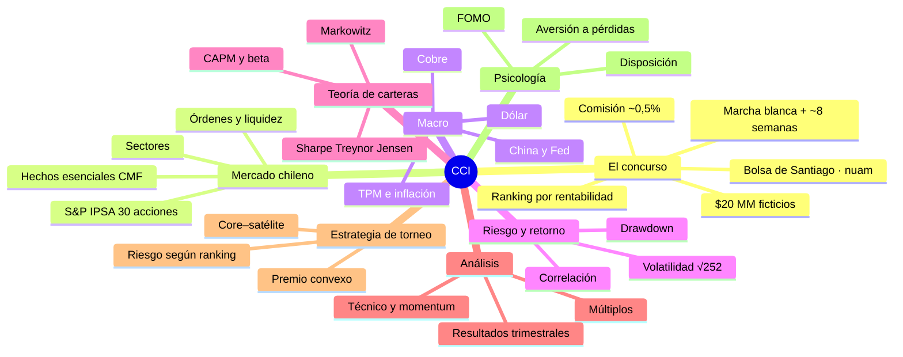

# Guía de estudio · Concurso Carteras de Inversión (CCI)

Material para prepararse para el CCI de la Bolsa de Santiago: teoría, mercado chileno, estrategia de torneo y práctica.

> Las reglas citadas son de ediciones anteriores del CCI ($20 MM ficticios, acciones del IPSA, comisión de 0,5%, equipos de hasta 5, ~8 semanas). **Confírmenlas en las bases vigentes.**

## Archivos

| # | Archivo | Qué es | Cómo abrirlo |
|---|---|---|---|
| 01 | `01_Guia_Completa_CCI.docx` | Guía principal: 16 capítulos, tablas, 8 esquemas, glosario y referencias | Word (al abrir, acepta actualizar campos para ver el índice) |
| 02 | `02_Resumen_Express_CCI.docx` | Todo lo esencial en pocas páginas | Word |
| 03 | `03_Laboratorio_CCI.xlsx` | 14 hojas con fórmulas y gráficos: retornos, correlaciones, frontera eficiente, cartera + Solver, beta/CAPM, técnico, drawdown, **simulador del concurso**, torneo, screener, calendario y plan de estudio | Excel (datos de ejemplo ficticios; ver hoja 0 para cargar datos reales) |
| 04 | `04_Mapas_y_Esquemas.html` | Mapa mental y 9 esquemas (funciona sin internet) | Navegador |
| 04 | `04_Esquemas_PNG/` | Los mismos esquemas como imágenes | Cualquier visor |
| 04b | `04b_Mapa_Mental_CCI.mm` | Mapa mental editable | FreeMind, Freeplane, XMind (importar) o MindMeister |
| 05 | `05_Ejercicios_Resueltos_CCI.docx` | 18 ejercicios con solución paso a paso | Word |
| 06 | `06_Quiz_Interactivo_CCI.html` | 45 preguntas en 12 bloques, con corrección y explicación | Navegador |
| 07 | `07_Flashcards_Anki_CCI.txt` / `.csv` | 86 tarjetas de memoria | Anki (Archivo → Importar) o Quizlet / Excel |
| 08 | `08_Plantilla_Estrategia_Equipo.docx` | Plan de estrategia del equipo para llenar | Word |
| — | `_build/` | Scripts que generan todo el material | Python 3 (opcional) |

## Orden de estudio (3 semanas)

1. **Semana 1:** Guía cap. 0–7 · Excel hojas 1–6 · Ejercicios 1–9 · Quiz bloques Concurso, Torneo, Mercado, Macro, Riesgo, Carteras, CAPM.
2. **Semana 2:** Guía cap. 8–13 · Excel hojas 7–11 · Ejercicios 10–18 · llenar la Plantilla de Estrategia.
3. **Semana 3:** Marcha blanca con las hojas 9 y 12 · Quiz completo · Resumen Express antes de cada sesión.

## Mapa mental

